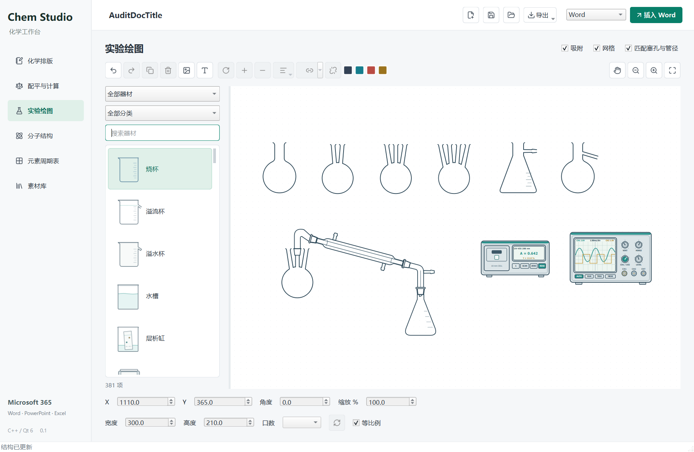
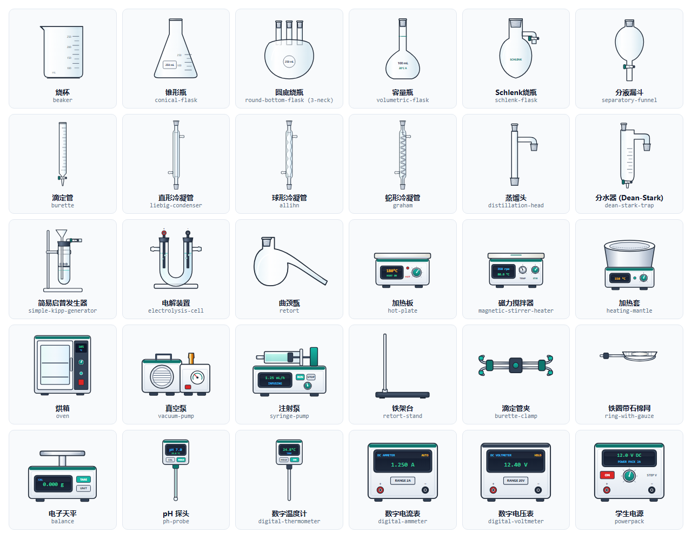
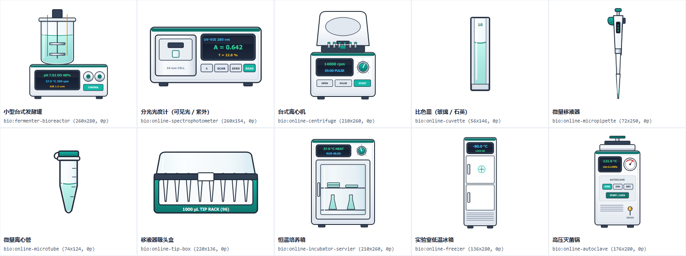

# Chem Studio

**实验报告里的图，试着少画一点。**

一个面向化学、生物化学与物理实验报告的 Windows 桌面工作台。把装置示意图、硬件连接图、化学式、反应配平、元素周期表和分子结构放在一起，尽量减少在几个软件之间来回折腾。

> 使用前，请确认你的老师允许打印实验报告，而不是要求纯手绘。
>
> 本项目推荐宿舍有打印机，或者学校打印机很便宜的同学使用。如果学校打印机彩打高达一块钱一面，请您谨慎使用。



## 为什么做这个

我是个大学生。上化学实验和生物化学实验课，写报告的时候，经常要画实验装置图，有时还要补硬件连接图。

实验课上完已经够累了，反正我是不想手画实验报告上面的图，并且我一学食科的，为什么要会画画。试了一圈市面上的工具，我自己的感受是：**要么付费，要么不好使，还有些付费了也不好使。**

说到底，就是不想再手动画了。

于是我开始了这次 vibe coding：把需求描述出来，让 AI 帮着写，我负责试、提需求、挑毛病，再继续改。起初只想让它帮我少画几张图，后来越做越多——器材连接、图片和文字、分子结构、Office 导出，也就慢慢有了现在的 Chem Studio。

过程中最真实的部分，大概不是“几句话就做出一个软件”，而是发现导管没对上、塞子凭空多了个洞、图导出去又变了样，然后一件件修。还有不少粗糙的地方，不过已经值得拿出来分享了。

开发时使用的 AI 接入渠道是 [AgentRouter](https://agentrouter.org/register?aff=6c4F)（这是我的邀请链接）。想试试类似的开发方式，可以从这里开始；使用 Chem Studio 本身不需要注册这个渠道，也不需要 AI API Key。

欢迎使用，欢迎吐槽，也欢迎一起把它改得更好。能帮你少花一点画图的时间，这个项目就没白做。

## 可以做什么

- **装置与连接图**：内置 **409 项纯矢量 SVG 素材**（233 项基础器材含 12 项新增玻器与硬件、55 项有机蒸馏与分析仪器、50 项生化器材、71 项物理与电工器材；含 2–4 颈圆底烧瓶变体共 412 个 SVG 文件），全库统一为通透玻璃渐变、高光与磨砂标准磨口的精绘插画风格，经去重后提供 **399 项不重名可检索器材与基本图形**，按 **10 大功能领域**（容器与反应、分离与纯化、管路与接口、加热与温控、计量与分析、生物与生化、电学与电路、力学光学声学、支架夹具与安全、标注与基本图形）及二级子分类组织。支持拖放、缩放、旋转、对齐、连线、断开与撤销，并向后兼容旧版 `.chem` 存档 ID。
- **严谨玻璃器材与冷凝管规范**：单口至四口圆底烧瓶（1–4 颈变体一键切换）、直形/球形/蛇形/双层盘管/弗里德里希冷凝管及旋转蒸发仪均采用标准逆流冷却水口（`water-in` 位于下方、`water-out` 位于上方且严格位于冷凝管对侧），蛇形冷凝管采用平滑螺旋盘管，带磨砂锥形标准磨口（含无支管/带支管/克氏蒸馏头、刺形分馏柱、磨口锥形瓶、直形/弯形/真空/三头牛角接收管、分水器等），直接吸附对齐。
- **离线语义与关键词搜索**：默认跨全部领域检索，支持 `BAAI/bge-small-zh-v1.5` 量化 ONNX 模型（ONNX Runtime 1.20.1 CPU 离线推理）与关键词即时回退检索，可用自然语言描述（如「抽滤时接真空泵的瓶子」「无支管蒸馏头」「观察电压随时间变化的波形」）快速定位器材并按回车插入画布。
- **图片与文字**：插入图片（保持矢量 SVG 无损导入）、多行文字，双击编辑文字，适合给装置图加标签或补硬件模块。
- **器材装配与柔性探头**：按连接口吸附，调整插入深度；塞孔只在实际连接时显示；提供 90° 弯管和多颈烧瓶。示波器探针、BNC 插头、接地夹及电线、软管端点可分别拖动，探头倍率可设为 1X–1000X，靠近兼容的空闲插孔会预览吸附，松手连接。
- **全新元素周期表**：覆盖全部 118 号元素完整物化数据与中文名称，支持 10 类元素分类高亮筛选与实时检索（序数、符号、中英文名称、分类），并在详情面板内置动态 **Bohr 电子层模型图**、结构化性质表以及一键「插入文稿」「复制信息」「计算摩尔质量」。
- **化学工具与分子结构**：化学式排版、摩尔质量和元素组成、反应配平与化学计量；内置离线 Ketcher / Indigo 结构绘制画布及 SMILES / MOL 导入，支持二维结构与 Three.js 三维构象查看。
- **报告输出**：按当前页面导出 PNG、SVG、PDF、HTML、LaTeX、MOL、SMILES、KET、RXN 等格式，保存 `.chem` 项目；提供 Word、PowerPoint、Excel 的插入入口。

器材图是用于报告的简化示意图；其中一部分是供自由排版的符号，不具有自动装配连接口。实际支持的导出格式取决于当前页面。



新增的生化器材覆盖离心、取样、分析计量、分离纯化、电泳成像和常用生化设备。



## 开始使用

当前提供源码版本，支持 **Windows x64**。完整步骤见 [构建指南](docs/BUILD.md)。

先安装 MSYS2 UCRT64 的 Qt 6、Open Babel 和编译工具，再在项目根目录执行：

```powershell
npm ci
.\scripts\setup-deps.ps1
.\scripts\fetch-semantic-model.ps1   # 可选：下载 bge-small-zh-v1.5 离线向量模型（不下载亦可回退关键词检索）
.\scripts\build.ps1
.\scripts\run.ps1
```

运行需要 Microsoft Edge WebView2 Runtime。Office 插入功能需要已安装相应桌面版 Office；普通画图与文件导出不需要 Office。

## 文档

- [构建与测试](docs/BUILD.md)
- [使用说明](docs/USAGE.md)
- [离线器材语义搜索](docs/APPARATUS_SEARCH.md)
- [项目结构与器材扩展](docs/ARCHITECTURE.md)
- [第三方依赖与许可](docs/THIRD_PARTY.md)
- [结构绘制与文件](docs/STRUCTURE_EDITOR.md)
- [参与贡献](CONTRIBUTING.md)
- [更新记录](CHANGELOG.md)

## 接下来想做的事

- 补充更常用的实验装置模板，完善器材造型与连接口。
- 改善小屏幕布局、导出效果和异常提示。
- 完善安装包与依赖部署，降低第一次使用的门槛。
- 增加生物化学实验与硬件连接图的素材。

## 开源协议

本项目编写的代码、文档、`assets/apparatus`（233 项）、`assets/laboratory`（55 项）、`assets/biochemistry`（全部 50 项均已重绘为原创图）和 `assets/physics`（71 项）均采用 **WTFPL v2**，详见 [LICENSE](LICENSE) 与 [生化素材清单](assets/biochemistry/ATTRIBUTION.md)。欢迎使用、修改和分享。

离线向量检索模型（`BAAI/bge-small-zh-v1.5`，MIT）和推理运行时（ONNX Runtime 1.20.1，MIT）及第三方库各自保留其上游许可，详见 [第三方说明](docs/THIRD_PARTY.md)。
