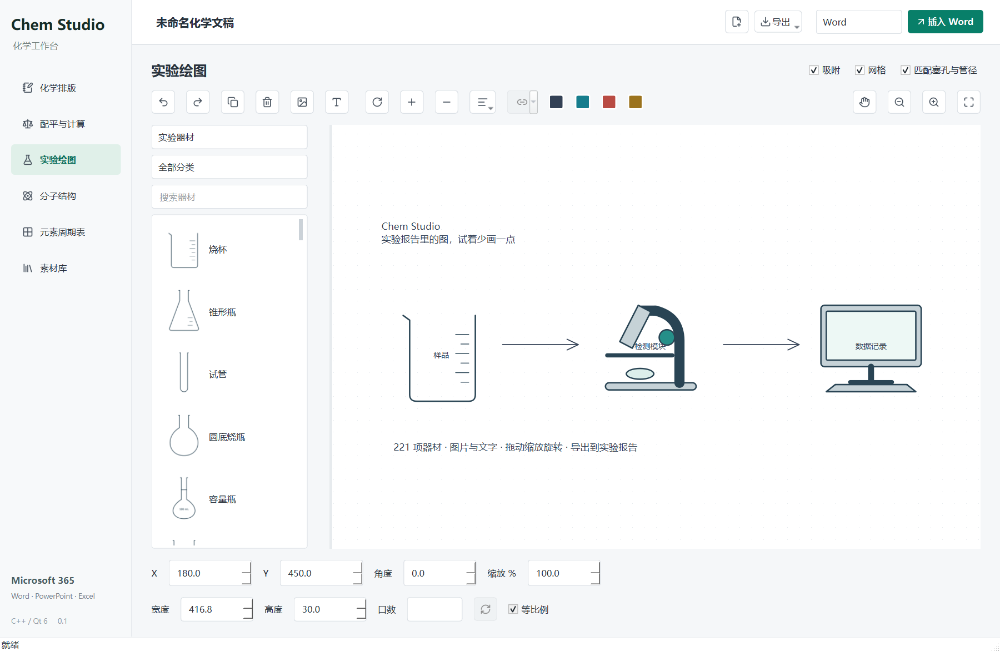
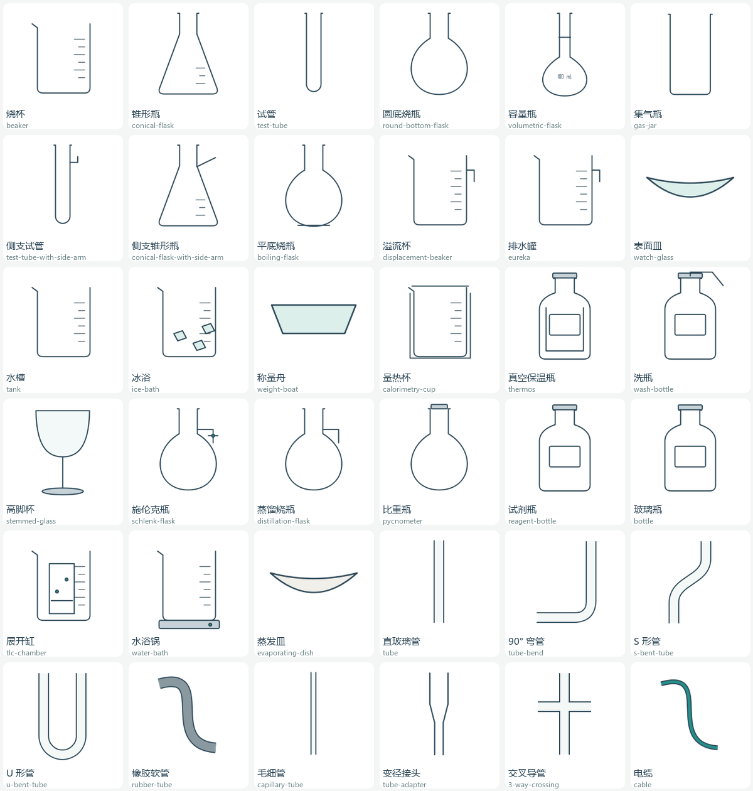

# Chem Studio

**实验报告里的图，试着少画一点。**

一个面向化学、生物化学实验报告的 Windows 桌面工作台。把装置示意图、硬件连接图、化学式、反应配平和分子结构放在一起，尽量减少在几个软件之间来回折腾。

> 使用前，请确认你的老师允许打印实验报告，而不是要求纯手绘。
>
> 本项目推荐宿舍有打印机，或者学校打印机很便宜的同学使用。如果学校打印机彩打高达一块钱一面，请您谨慎使用。



## 为什么做这个

我是个大学生。上化学实验和生物化学实验课，写报告的时候，经常要画实验装置图，有时还要补硬件连接图。

实验课上完已经够累了，反正我是不想手画实验报告上面的图，并且我一学食科的，为什么要会画画。试了一圈市面上的工具，我自己的感受是：**要么付费，要么不好使，还有些付费了也不好使。**

说到底，就是不想再手动画了。

于是我开始了这次 vibe coding：把需求描述出来，让 AI 帮着写，我负责试、提需求、挑毛病，再继续改。起初只想让它帮我少画几张图，后来越做越多——器材连接、图片和文字、分子结构、Office 导出，也就慢慢有了现在的 Chem Studio。

过程中最真实的部分，大概不是“几句话就做出一个软件”，而是发现导管没对上、塞子凭空多了个洞、图导出去又变了样，然后一件件修。还有不少粗糙的地方，不过已经值得拿出来分享了。

开发时使用的 AI 接入渠道是 [AgentRouter](https://agentrouter.org/register?aff=6c4F)（这是我的邀请链接）。想试试类似的开发方式，可以从这里开始；使用 Chem Studio 本身不需要注册这个渠道，也不需要 AI API Key。

欢迎使用，欢迎吐槽，也欢迎一起把它改得更好。能帮你少花一点画图的时间，这个项目就没白做。

## 可以做什么

- **装置与连接图**：内置 221 项 SVG 器材示意图，覆盖容器、导管、冷凝、加热、电学、光学、生物实验等；支持拖放、缩放、旋转、对齐、连线和撤销。
- **图片与文字**：插入图片、多行文字，双击编辑文字，适合给装置图加标签或补硬件模块。
- **器材装配**：按连接口吸附，调整插入深度；塞孔只在实际连接时显示；提供 90° 弯管和多颈烧瓶。
- **化学工具**：化学式排版、摩尔质量和元素组成、反应配平、化学计量、元素信息。
- **分子结构**：由 SMILES 生成二维结构和三维预览，导出分子相关文件。
- **报告输出**：按当前页面导出 PNG、SVG、PDF 等格式，保存 `.chem` 项目；提供 Word、PowerPoint、Excel 的插入入口。

器材图是用于报告的简化示意图；其中一部分是供自由排版的符号，不具有自动装配连接口。实际支持的导出格式取决于当前页面。



## 开始使用

当前提供源码版本，支持 **Windows x64**。完整步骤见 [构建指南](docs/BUILD.md)。

先安装 MSYS2 UCRT64 的 Qt 6、Open Babel 和编译工具，再在项目根目录执行：

```powershell
npm ci
.\scripts\setup-deps.ps1
.\scripts\build.ps1
.\scripts\run.ps1
```

运行需要 Microsoft Edge WebView2 Runtime。Office 插入功能需要已安装相应桌面版 Office；普通画图与文件导出不需要 Office。

## 文档

- [构建与测试](docs/BUILD.md)
- [使用说明](docs/USAGE.md)
- [项目结构与器材扩展](docs/ARCHITECTURE.md)
- [第三方依赖与许可](docs/THIRD_PARTY.md)
- [参与贡献](CONTRIBUTING.md)
- [更新记录](CHANGELOG.md)

## 接下来想做的事

- 补充更常用的实验装置模板，完善器材造型与连接口。
- 改善小屏幕布局、导出效果和异常提示。
- 完善安装包与依赖部署，降低第一次使用的门槛。
- 增加生物化学实验与硬件连接图的素材。

## 开源协议

本项目编写的代码、文档和 `assets/apparatus` 器材图采用 **WTFPL v2**，详见 [LICENSE](LICENSE)。欢迎使用、修改和分享。

第三方库保留各自的许可；WTFPL 不覆盖 Qt、Open Babel 等依赖。发布包含依赖的构建产物时，请同时遵守相应条款，详见 [第三方说明](docs/THIRD_PARTY.md)。
